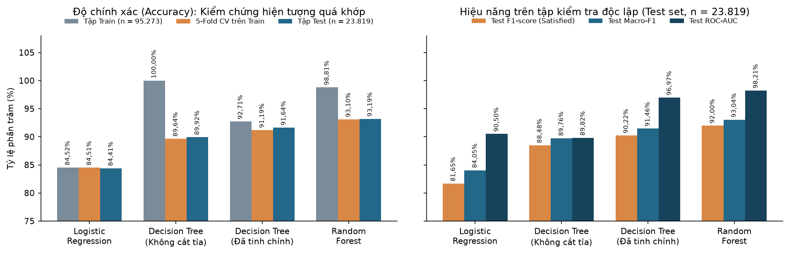
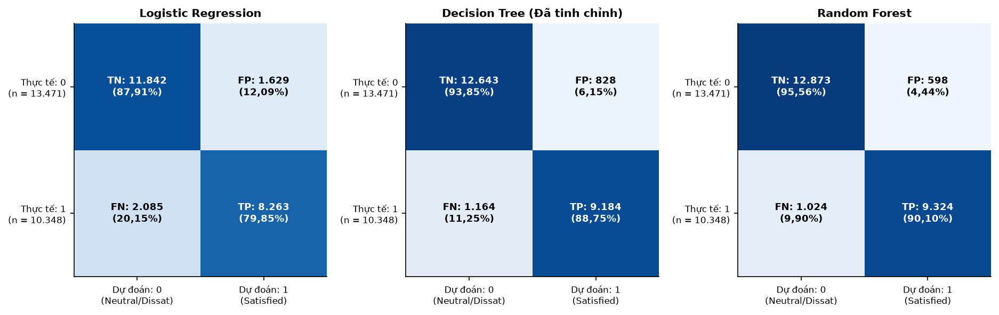
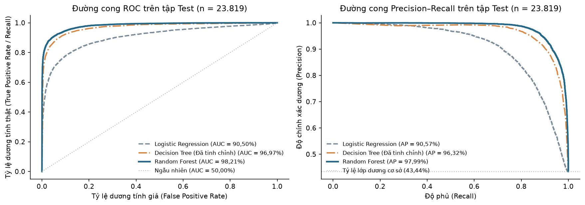
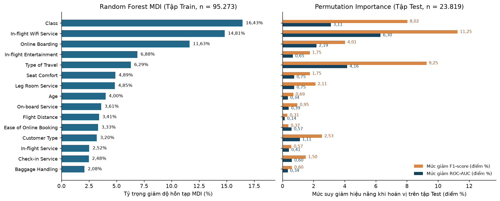
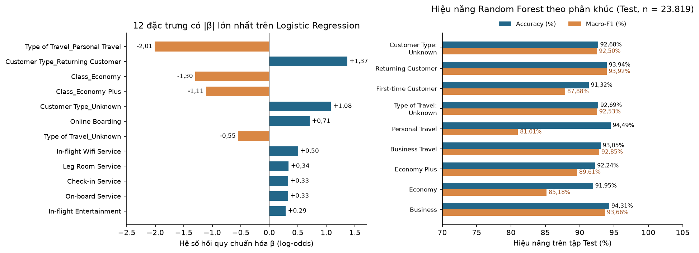

# Chương 4. Xây dựng, đánh giá và giải thích mô hình học máy dự đoán sự hài lòng của hành khách hàng không {#sec-chuong4}

Chương này triển khai hai giai đoạn tiếp theo của quy trình CRISP-DM đã xác lập ở Chương 2: **chuẩn bị đặc trưng để mô hình hóa** ([mục 4.1](#sec-4-1)) và **huấn luyện, tinh chỉnh, đánh giá mô hình học máy** ([mục 4.2](#sec-4-2)–[mục 4.5](#sec-4-5)), nhằm trả lời câu hỏi nghiên cứu **RQ4** ở Chương 1 về khả năng dự đoán mức độ hài lòng của hành khách bằng các thuật toán phân loại (**Logistic Regression, Decision Tree, Random Forest**), đồng thời cung cấp cơ sở định lượng đã kiểm chứng về mức độ quan trọng của đặc trưng (*Feature Importance*) để xây dựng hàm ý quản trị ở Chương 5 (**RQ5**). Toàn bộ thực nghiệm tuân thủ nghiêm ngặt các nguyên tắc kỹ thuật đã chốt ở Mục 3.6.3 của Chương 3: chỉ sử dụng **119.092 bản ghi** có nhãn mục tiêu quan sát thực tế, loại bỏ khóa định danh `ID`, bảo toàn danh mục `Unknown` và khôi phục trạng thái dữ liệu trước bước điền khuyết toàn cục để chia tập huấn luyện – kiểm tra (80/20 phân tầng) trước khi học mọi thống kê tiền xử lý trong `Pipeline`.

## 4.1. Thiết kế thực nghiệm, tiền xử lý chống rò rỉ và chuẩn bị ma trận đặc trưng {#sec-4-1}

### 4.1.1. Xác lập tập mẫu, biến mục tiêu và khôi phục trạng thái trước điền khuyết {#sec-4-1-1}

Như đã chứng minh tại Mục 3.3.4 và Mục 3.6.3 của Chương 3, tệp dữ liệu sạch `Data/processed/PJ21.csv` (119.092 dòng × 24 cột) đã được điền Mode và trung vị tính trên toàn bộ 119.092 dòng. Nếu nạp trực tiếp `PJ21.csv` vào mô hình, việc đặt `SimpleImputer` trong `Pipeline` sẽ không phát huy tác dụng chống rò rỉ dữ liệu (*Data Leakage*) vì không còn ô `NaN` nào để bộ điền khuyết học riêng trên tập huấn luyện.

Để giải quyết triệt để vấn đề này mà vẫn đảm bảo tính nhất quán 100% với quy tắc làm sạch của dự án, mã nguồn `src/phan_tich_chuong4.py` tái tạo ma trận đặc trưng **trước bước điền khuyết** ($X_{\text{pre}}$) trực tiếp từ `Data/raw/Du lieu khong sach.csv` thông qua đúng ba bước đầu của `lam_sach_du_lieu.py`: (1) chuẩn hóa chuỗi phân loại theo bảng ánh xạ từ điển, (2) trích xuất số và chuyển các giá trị ngoài miền quy ước `BOUNDS` thành `NaN`, và (3) lọc đúng 119.092 bản ghi có nhãn `Satisfaction` hợp lệ. Phép kiểm định tự động xác nhận:

- Cột khóa `ID` và nhãn `Satisfaction` của $X_{\text{pre}}$ khớp tuyệt đối 1–1 theo đúng thứ tự dòng với `Data/processed/PJ21.csv`.
- Khi áp dụng bước điền khuyết toàn cục lên $X_{\text{pre}}$, khung dữ liệu thu được khớp 100% từng ô với `Data/processed/PJ21.csv` (`pd.testing.assert_frame_equal` thành công).

Sau bước đối chiếu, cột `ID` được loại bỏ hoàn toàn khỏi ma trận đặc trưng để ngăn mô hình cây ghi nhớ số thứ tự bản ghi. Ma trận đặc trưng đầu vào $X$ gồm **22 biến giải thích**: 4 biến phân loại (`Gender`, `Customer Type`, `Type of Travel`, `Class`), 4 biến định lượng vận hành (`Age`, `Flight Distance`, `Departure Delay`, `Arrival Delay`) và 14 biến điểm đánh giá dịch vụ. Biến mục tiêu $y$ được mã hóa nhị phân theo quy ước ở Mục 2.4.8: `1 = Satisfied` (51.740 bản ghi, chiếm `43,45%`) và `0 = Neutral or Dissatisfied` (67.352 bản ghi, chiếm `56,55%`).

### 4.1.2. Phân chia tập huấn luyện – kiểm tra phân tầng (80/20) và kiểm chứng thống kê điền khuyết {#sec-4-1-2}

Tập mẫu 119.092 bản ghi được chia ngẫu nhiên một lần duy nhất bằng `train_test_split(..., test_size=0.20, stratify=y, random_state=42)` thành:

- **Tập huấn luyện (`Train set`, 80%):** **95.273 bản ghi**, gồm 41.392 bản ghi `Satisfied` (**43,45%**) và 53.881 bản ghi `Neutral or Dissatisfied` (**56,55%**).
- **Tập kiểm tra độc lập (`Test set`, 20%):** **23.819 bản ghi**, gồm 10.348 bản ghi `Satisfied` (**43,44%**) và 13.471 bản ghi `Neutral or Dissatisfied` (**56,56%**).

@tbl-split-impute đối chiếu tỷ lệ ô khuyết giữa hai tập cùng giá trị điền khuyết được học **chỉ trên tập `Train`** (`n = 95.273`) so với giá trị điền khuyết toàn cục trên `PJ21.csv` (`n = 119.092`). Kết quả cho thấy **21/22 biến** có giá trị Mode hoặc trung vị học trên tập `Train` trùng khớp tuyệt đối với giá trị toàn tập trên `PJ21.csv` (`Gender = Female`, `Class = Business`, `Customer Type = Unknown`, `Type of Travel = Unknown`, `Age = 40,0`, hai biến độ trễ `= 0,0`, 8 biến dịch vụ `= 3,0` và 6 biến dịch vụ `= 4,0`). Chỉ có duy nhất biến `Flight Distance` có trung vị trên tập `Train` là **849,0** so với **846,0** trên toàn tập `PJ21.csv` (chênh lệch 3 đơn vị, tương đương 0,35%). Phát hiện này chứng minh quy mô mẫu lớn và việc chia phân tầng đã giữ cho thống kê tiền xử lý rất ổn định, đồng thời giúp giải thích vì sao sự khác biệt hiệu năng giữa `Pipeline` chống rò rỉ và `PJ21.csv` ở [mục 4.3.3](#sec-4-3-3) là rất nhỏ.

| Biến | Nhóm | Chiến lược trong Pipeline | Ô khuyết Train (%) | Ô khuyết Test (%) | Giá trị học trên Train | Giá trị trên PJ21.csv | Khớp |
|---|---|---|---|---|---|---|---|
| Gender | Phân loại | Mode trên Train | 7.646 (8,03%) | 1.871 (7,86%) | Female | Female | Khớp |
| Customer Type | Phân loại | Hằng số 'Unknown' | 32.406 (34,01%) | 8.002 (33,60%) | Unknown | Unknown | Khớp |
| Type of Travel | Phân loại | Hằng số 'Unknown' | 36.477 (38,29%) | 9.130 (38,33%) | Unknown | Unknown | Khớp |
| Class | Phân loại | Mode trên Train | 7.248 (7,61%) | 1.865 (7,83%) | Business | Business | Khớp |
| Age | Định lượng vận hành | Trung vị trên Train | 7.180 (7,54%) | 1.832 (7,69%) | 40,0 | 40,0 | Khớp |
| Flight Distance | Định lượng vận hành | Trung vị trên Train | 18.281 (19,19%) | 4.510 (18,93%) | 849,0 | 846,0 | **Lệch nhẹ** |
| Departure Delay | Định lượng vận hành | Trung vị trên Train | 33.223 (34,87%) | 8.191 (34,39%) | 0,0 | 0,0 | Khớp |
| Arrival Delay | Định lượng vận hành | Trung vị trên Train | 6.419 (6,74%) | 1.619 (6,80%) | 0,0 | 0,0 | Khớp |
| Departure and Arrival Time Convenience | Điểm dịch vụ [0, 5] | Trung vị trên Train | 9.872 (10,36%) | 2.510 (10,54%) | 3,0 | 3,0 | Khớp |
| Ease of Online Booking | Điểm dịch vụ [0, 5] | Trung vị trên Train | 28.228 (29,63%) | 7.195 (30,21%) | 3,0 | 3,0 | Khớp |
| Check-in Service | Điểm dịch vụ [0, 5] | Trung vị trên Train | 11.132 (11,68%) | 2.816 (11,82%) | 3,0 | 3,0 | Khớp |
| Online Boarding | Điểm dịch vụ [0, 5] | Trung vị trên Train | 25.572 (26,84%) | 6.386 (26,81%) | 3,0 | 3,0 | Khớp |
| Gate Location | Điểm dịch vụ [0, 5] | Trung vị trên Train | 21.305 (22,36%) | 5.366 (22,53%) | 3,0 | 3,0 | Khớp |
| On-board Service | Điểm dịch vụ [0, 5] | Trung vị trên Train | 7.561 (7,94%) | 1.939 (8,14%) | 4,0 | 4,0 | Khớp |
| Seat Comfort | Điểm dịch vụ [0, 5] | Trung vị trên Train | 13.655 (14,33%) | 3.464 (14,54%) | 4,0 | 4,0 | Khớp |
| Leg Room Service | Điểm dịch vụ [0, 5] | Trung vị trên Train | 6.626 (6,95%) | 1.712 (7,19%) | 4,0 | 4,0 | Khớp |
| Cleanliness | Điểm dịch vụ [0, 5] | Trung vị trên Train | 30.702 (32,23%) | 7.739 (32,49%) | 3,0 | 3,0 | Khớp |
| Food and Drink | Điểm dịch vụ [0, 5] | Trung vị trên Train | 25.523 (26,79%) | 6.379 (26,78%) | 3,0 | 3,0 | Khớp |
| In-flight Service | Điểm dịch vụ [0, 5] | Trung vị trên Train | 8.765 (9,20%) | 2.278 (9,56%) | 4,0 | 4,0 | Khớp |
| In-flight Wifi Service | Điểm dịch vụ [0, 5] | Trung vị trên Train | 18.688 (19,62%) | 4.630 (19,44%) | 3,0 | 3,0 | Khớp |
| In-flight Entertainment | Điểm dịch vụ [0, 5] | Trung vị trên Train | 9.375 (9,84%) | 2.308 (9,69%) | 4,0 | 4,0 | Khớp |
| Baggage Handling | Điểm dịch vụ [0, 5] | Trung vị trên Train | 21.107 (22,15%) | 5.261 (22,09%) | 4,0 | 4,0 | Khớp |

: Đối chiếu tỷ lệ ô khuyết và giá trị điền khuyết học riêng trên tập `Train` (n = 95.273) với giá trị toàn cục trên `PJ21.csv` (n = 119.092) {#tbl-split-impute}

*Nguồn: Tính toán từ ma trận trước điền khuyết và lưu tại `outputs/chuong4/doi_chieu_dien_khuyet_train_vs_pj21.csv`.*

### 4.1.3. Kiến trúc `Pipeline` tiền xử lý, mã hóa đặc trưng và kiểm tra đa cộng tuyến (VIF) {#sec-4-1-3}

Toàn bộ quá trình biến đổi đặc trưng được đóng gói trong `ColumnTransformer` đặt bên trong `sklearn.pipeline.Pipeline` theo ba nhánh xử lý song song:

1. **Nhánh phân loại khuyết thấp (`Gender`, `Class`):** Điền khuyết bằng `SimpleImputer(strategy="most_frequent")` học trên tập huấn luyện, sau đó mã hóa nhị phân bằng `OneHotEncoder(handle_unknown="ignore")`.
2. **Nhánh phân loại khuyết cao (`Customer Type`, `Type of Travel`):** Điền khuyết bằng `SimpleImputer(strategy="constant", fill_value="Unknown")` để giữ nguyên nhóm `Unknown` thành một danh mục độc lập theo đúng kết luận của Mục 3.5.1, sau đó áp dụng `OneHotEncoder`.
3. **Nhánh 18 biến định lượng (`4` biến vận hành và `14` biến dịch vụ):** Điền khuyết bằng `SimpleImputer(strategy="median")` học trên tập huấn luyện. Đối với **Logistic Regression**, nhánh này được nối tiếp với `StandardScaler()` ($z = (x - \mu_{\text{train}}) / \sigma_{\text{train}}$) và `OneHotEncoder(drop="first")` ở hai nhánh phân loại để tránh đa cộng tuyến hoàn hảo với hệ số chặn (tạo ra **25 đặc trưng** sau mã hóa: 7 biến giả phân loại và 18 biến định lượng chuẩn hóa). Đối với **Decision Tree** và **Random Forest**, giữ nguyên giá trị số sau điền trung vị và giữ đầy đủ các cột One-Hot Encoding (`drop=None`, tạo ra **29 đặc trưng** sau mã hóa) để các nút cây có thể phân tách trực tiếp trên từng danh mục.

Để kiểm tra hiện tượng đa cộng tuyến giữa 18 biến định lượng đã ghi nhận từ ma trận tương quan ở Chương 3, hệ số phóng đại phương sai $\text{VIF}_j = 1 / (1 - R_j^2)$ được tính trên tập `Train` tại @tbl-vif.

| Hạng VIF | Biến định lượng | Nhóm biến | $R^2$ với các biến số khác | Hệ số phóng đại phương sai (VIF) |
|---|---|---|---|---|
| 1 | In-flight Entertainment | Điểm dịch vụ | 0,5745 | 2,3499 |
| 2 | Seat Comfort | Điểm dịch vụ | 0,4226 | 1,7318 |
| 3 | In-flight Service | Điểm dịch vụ | 0,4141 | 1,7068 |
| 4 | Cleanliness | Điểm dịch vụ | 0,3892 | 1,6372 |
| 5 | Ease of Online Booking | Điểm dịch vụ | 0,3742 | 1,5980 |
| 6 | In-flight Wifi Service | Điểm dịch vụ | 0,3690 | 1,5847 |
| 7 | On-board Service | Điểm dịch vụ | 0,3536 | 1,5470 |
| 8 | Food and Drink | Điểm dịch vụ | 0,3505 | 1,5396 |
| 9 | Baggage Handling | Điểm dịch vụ | 0,3396 | 1,5141 |
| 10 | Online Boarding | Điểm dịch vụ | 0,2774 | 1,3839 |
| 11 | Departure and Arrival Time Convenience | Điểm dịch vụ | 0,2244 | 1,2893 |
| 12 | Gate Location | Điểm dịch vụ | 0,2142 | 1,2726 |
| 13 | Leg Room Service | Điểm dịch vụ | 0,1928 | 1,2389 |
| 14 | Arrival Delay | Định lượng vận hành | 0,1283 | 1,1472 |
| 15 | Departure Delay | Định lượng vận hành | 0,1273 | 1,1459 |
| 16 | Check-in Service | Điểm dịch vụ | 0,1241 | 1,1417 |
| 17 | Age | Định lượng vận hành | 0,0571 | 1,0606 |
| 18 | Flight Distance | Định lượng vận hành | 0,0468 | 1,0491 |

: Hệ số xác định bội ($R^2$) và hệ số phóng đại phương sai (VIF) của 18 biến định lượng trên tập `Train` (n = 95.273) {#tbl-vif}

*Nguồn: `outputs/chuong4/kiem_tra_vif.csv`.*

Tại @tbl-vif, toàn bộ 18 biến định lượng đều có $\text{VIF} < 2,50$ (thấp hơn nhiều so với ngưỡng cảnh báo đa cộng tuyến $\text{VIF} \ge 5$). Biến có VIF cao nhất là `In-flight Entertainment` ($\text{VIF} = 2,3499$, $R^2 = 0,5745$), tiếp theo là `Seat Comfort` (1,7318), `In-flight Service` (1,7068), `Cleanliness` ($1,6372$) và `Ease of Online Booking` ($1,5980$) do nhóm tiêu chí tiện nghi trên khoang và đặt vé – Wi-Fi có tương quan thuận trung bình như đã chỉ ra ở Hình 3.5. Hai biến `Arrival Delay` và `Departure Delay` trên tập `Train` sau điền khuyết có tương quan Pearson $r = 0,3558$ (Spearman $\rho = 0,4713$) do 34,87% ô `Departure Delay` bị khuyết độc lập với `Arrival Delay` được điền `0`, dẫn tới VIF chỉ ở mức $1,1472$ và $1,1459$. Điều này khẳng định ma trận đặc trưng hoàn toàn ổn định cho cả hồi quy Logistic có điều chuẩn L2 lẫn các mô hình cây.

## 4.2. Huấn luyện mô hình và tinh chỉnh siêu tham số bằng kiểm định chéo {#sec-4-2}

### 4.2.1. Thiết lập kiểm định chéo phân tầng 5-Fold trên tập huấn luyện {#sec-4-2-1}

Theo quy tắc phòng chống rò rỉ dữ liệu tại Mục 2.4.7, tập `Test` (23.819 bản ghi) được niêm phong hoàn toàn trong suốt quá trình lựa chọn siêu tham số. Việc so sánh các cấu hình ứng viên được thực hiện bằng kiểm định chéo phân tầng 5-Fold (`StratifiedKFold(n_splits=5, shuffle=True, random_state=42)`) trên tập `Train` (95.273 bản ghi). Trong mỗi lượt lặp của 5-Fold CV, toàn bộ `Pipeline` được `fit` trên 4 phần dữ liệu huấn luyện ($\approx 76.218$ bản ghi) và đánh giá trên 1 phần kiểm định ($\approx 19.055$ bản ghi) theo bốn thước đo: Accuracy, F1-score của lớp `Satisfied (1)`, Macro-F1 và diện tích dưới đường cong ROC (ROC-AUC).

### 4.2.2. Kết quả lựa chọn siêu tham số và kiểm soát quá khớp {#sec-4-2-2}

@tbl-cv trình bày kết quả kiểm định chéo 5-Fold trên tập `Train` cho 12 cấu hình siêu tham số thuộc ba họ mô hình.

| Họ mô hình | Cấu hình siêu tham số | Train Acc (%) | CV Acc ± SD (%) | CV F1 lớp 1 (%) | CV Macro-F1 (%) | CV ROC-AUC ± SD (%) | Chênh Train–CV Acc (điểm %) |
|---|---|---|---|---|---|---|---|
| Logistic Regression | C = 0,01 (L2, drop='first') | 84,49 | 84,50 ± 0,25 | 81,81 | 84,15 | 90,54 ± 0,33 | -0,00 |
| Logistic Regression | C = 0,1 (L2, drop='first') | 84,53 | 84,51 ± 0,23 | 81,86 | 84,17 | 90,57 ± 0,32 | 0,02 |
| Logistic Regression | C = 1,0 (L2, drop='first' — chọn chính) | 84,52 | 84,51 ± 0,22 | 81,85 | 84,17 | 90,57 ± 0,32 | 0,02 |
| Logistic Regression | C = 1,0, class_weight='balanced' | 83,80 | 83,79 ± 0,29 | 81,72 | 83,58 | 90,56 ± 0,32 | 0,00 |
| Decision Tree | Không giới hạn (max_depth=None, min_samples_leaf=1) | 100,00 | 89,64 ± 0,34 | 88,12 | 89,47 | 89,50 ± 0,34 | 10,36 |
| Decision Tree | max_depth=8, min_samples_leaf=20 | 90,12 | 89,77 ± 0,20 | 88,08 | 89,56 | 95,73 ± 0,10 | 0,36 |
| Decision Tree | max_depth=14, min_samples_leaf=20 (chọn chính) | 92,57 | 91,19 ± 0,16 | 89,64 | 90,99 | 96,69 ± 0,14 | 1,38 |
| Decision Tree | max_depth=20, min_samples_leaf=20 | 92,96 | 91,35 ± 0,13 | 89,86 | 91,16 | 96,62 ± 0,14 | 1,61 |
| Random Forest | n_estimators=100, max_depth=12, min_samples_leaf=5 | 92,98 | 91,85 ± 0,22 | 90,44 | 91,67 | 97,44 ± 0,07 | 1,12 |
| Random Forest | n_estimators=200, max_depth=18, min_samples_leaf=2 | 97,42 | 92,96 ± 0,13 | 91,72 | 92,80 | 97,99 ± 0,06 | 4,46 |
| Random Forest | n_estimators=200, max_depth=None, min_samples_leaf=2 (chọn chính) | 98,78 | 93,10 ± 0,12 | 91,89 | 92,94 | 98,06 ± 0,06 | 5,68 |
| Random Forest | n_estimators=200, max_depth=None, min_samples_leaf=1 | 100,00 | 93,24 ± 0,17 | 92,05 | 93,09 | 98,10 ± 0,07 | 6,76 |

: Kết quả kiểm định chéo phân tầng 5-Fold trên tập `Train` (n = 95.273) cho các cấu hình siêu tham số {#tbl-cv}

*Nguồn: `outputs/chuong4/ket_qua_cv_sieu_tham_so.csv`.*

Từ @tbl-cv, có thể rút ra ba nhận định phương pháp luận quan trọng:

1. **Đối với Logistic Regression:** Hiệu năng kiểm định chéo hầu như bất biến khi hệ số điều chuẩn $C$ thay đổi từ $0,1$ đến $1,0$ (CV Accuracy đạt `84,51% ± 0,22%`, CV F1 lớp 1 đạt `81,85%`, CV Macro-F1 đạt `84,17%` và CV ROC-AUC đạt `90,57% ± 0,23%`), với độ chênh giữa Train và CV chỉ `0,01` điểm phần trăm — cho thấy mô hình tuyến tính hoàn toàn không bị quá khớp nhưng bị giới hạn bởi biên quyết định tuyến tính (hiện tượng *underfitting* tương đối so với các mô hình phi tuyến). Khi bật `class_weight="balanced"`, do tỷ lệ hai lớp vốn đã khá cân bằng (`43,45% / 56,55%`), việc ép trọng số ngược làm tăng dương tính giả (`FP`), khiến CV Accuracy giảm xuống `83,79%` và CV Macro-F1 giảm còn `83,58%`. Vì vậy, cấu hình chuẩn **`C = 1,0` (L2, không ép trọng số lớp)** được chọn làm mô hình Logistic Regression chính thức.
2. **Đối với Decision Tree (kiểm chứng trực tiếp hiện tượng quá khớp):** Khi không giới hạn độ sâu (`max_depth=None, min_samples_leaf=1`), cây quyết định đơn lẻ học thuộc hoàn toàn tập huấn luyện với **Train Accuracy = `100,00%`**, nhưng khi kiểm định chéo 5-Fold thì **CV Accuracy tụt xuống `89,64% ± 0,34%`** (chênh lệch Train–CV lên tới **`10,36` điểm phần trăm**) và **CV ROC-AUC chỉ đạt `89,50%`** (thậm chí thấp hơn cả Logistic Regression `90,57%` do các nút lá thuần nhất gồm 1 mẫu sinh ra xác suất dự đoán cực đoan 0 hoặc 1). Khi áp dụng cắt tỉa tiền định với `max_depth=14, min_samples_leaf=20`, độ chênh Train–CV giảm xuống còn `1,38` điểm phần trăm (`92,57%` so với `91,19%`), đồng thời **CV ROC-AUC tăng vọt thêm `+7,19` điểm phần trăm lên `96,69% ± 0,10%`**. Khi tăng `max_depth=20, min_samples_leaf=20`, CV ROC-AUC bắt đầu giảm nhẹ xuống `96,62%` và độ chênh Train–CV nới rộng (`1,61` điểm phần trăm). Do đó, cấu hình **`max_depth=14, min_samples_leaf=20`** được chọn làm mô hình Decision Tree đã tinh chỉnh (đồng thời giữ lại cấu hình không cắt tỉa ở Mục 4.3 để minh họa trực quan hiệu quả kiểm soát quá khớp).
3. **Đối với Random Forest:** Việc kết hợp đóng bao (*Bagging* 200 cây) và lấy mẫu ngẫu nhiên không gian đặc trưng tại mỗi nút giúp khắc phục triệt để nhược điểm phương sai cao của cây đơn. Khi tăng từ `100` cây (`max_depth=12, min_samples_leaf=5`: CV Accuracy `91,85%`, CV ROC-AUC `97,44%`) lên `200` cây với `max_depth=None, min_samples_leaf=2`, hiệu năng CV tăng lên **`93,10% ± 0,12%`** (CV Macro-F1 đạt **`92,94%`**, CV ROC-AUC đạt **`98,06% ± 0,06%`**) với độ lệch chuẩn giữa 5 fold rất thấp (`0,12%`). So với cấu hình `min_samples_leaf=1` (có Train Accuracy chạm `100,00%`, độ chênh Train–CV `6,76` điểm phần trăm mà CV ROC-AUC chỉ nhỉnh hơn `0,04` điểm phần trăm), cấu hình **`n_estimators=200, max_depth=None, min_samples_leaf=2`** kiểm soát độ phức tạp tại lá tốt hơn và cho ước lượng xác suất mượt hơn, nên được chọn làm mô hình Random Forest chính thức.

## 4.3. Đánh giá và so sánh hiệu năng dự đoán trên tập kiểm tra (RQ4) {#sec-4-3}

### 4.3.1. So sánh tổng thể các chỉ số đánh giá trên tập kiểm tra độc lập {#sec-4-3-1}

Sau khi chốt cấu hình từ 5-Fold CV, các `Pipeline` được huấn luyện lại trên toàn bộ tập `Train` (n = 95.273) và đánh giá một lần duy nhất trên tập `Test` độc lập (n = 23.819). @tbl-test-metrics và @fig-model-comp tổng hợp toàn diện các chỉ số hiệu năng theo cả hai lớp (`Satisfied = 1` và `Neutral or Dissatisfied = 0`).

| Mô hình | Train Acc (%) | Test Acc (%) | Prec lớp 1 (%) | Rec lớp 1 (%) | F1 lớp 1 (%) | F1 lớp 0 (%) | Macro-F1 (%) | ROC-AUC (%) | PR-AUC (%) | Brier Score |
|---|---|---|---|---|---|---|---|---|---|---|
| Logistic Regression | 84,52 | 84,41 | 83,53 | 79,85 | 81,65 | 86,44 | 84,05 | 90,50 | 90,57 | 0,1155 |
| Decision Tree (Không cắt tỉa) | 100,00 | 89,92 | 87,93 | 89,03 | 88,48 | 91,05 | 89,76 | 89,82 | 83,05 | 0,1008 |
| Decision Tree (Đã tinh chỉnh) | 92,71 | 91,64 | 91,73 | 88,75 | 90,22 | 92,70 | 91,46 | 96,97 | 96,32 | 0,0618 |
| Random Forest | 98,81 | 93,19 | 93,97 | 90,10 | 92,00 | 94,07 | 93,04 | 98,21 | 97,99 | 0,0519 |

: So sánh hiệu năng dự đoán của các mô hình phân loại trên tập kiểm tra độc lập (Test set, n = 23.819) {#tbl-test-metrics}

*Nguồn: `outputs/chuong4/hieu_nang_mo_hinh.csv`.*

{#fig-model-comp width=100%}

*Nguồn: Trích xuất từ `outputs/chuong4/hieu_nang_mo_hinh.csv` bằng `src/phan_tich_chuong4.py`.*

Kết quả trên tập `Test` (n = 23.819) tại @tbl-test-metrics và @fig-model-comp trả lời trực tiếp câu hỏi nghiên cứu **RQ4**:

- **Random Forest đạt hiệu năng vượt trội trên toàn bộ các thước đo:** Mô hình đạt độ chính xác tổng thể **Accuracy = 93,19%** (cao hơn Logistic Regression **+8,78 điểm phần trăm** và cao hơn Decision Tree đã tinh chỉnh **+1,55 điểm phần trăm**). Trên lớp mục tiêu `Satisfied (1)`, Random Forest đạt **Precision = 93,97%**, **Recall = 90,10%** và **F1-score = 92,00%**; trên lớp `Neutral or Dissatisfied (0)`, F1-score đạt **94,07%**, đưa **Macro-F1 lên 93,04%**. Khả năng phân biệt thứ hạng xác suất trên mọi ngưỡng cắt đạt **ROC-AUC = 98,21%** và **PR-AUC = 97,99%**, đồng thời sai số bình phương xác suất thấp nhất (**Brier Score = 0,0519**, Log-Loss = 0,1837).
- **Hiệu quả của việc cắt tỉa cây quyết định đơn (Decision Tree):** Việc giới hạn `max_depth=14, min_samples_leaf=20` không chỉ giúp tăng Test Accuracy từ 89,92% (ở cây không cắt tỉa) lên **91,64%** (Macro-F1 tăng từ 89,76% lên **91,46%**) mà đặc biệt giúp **Test ROC-AUC tăng thêm +7,15 điểm phần trăm** (từ 89,82% lên **96,97%**) và giảm Brier Score gần một nửa (từ 0,1008 xuống 0,0618).
- **Khoảng cách giữa mô hình tuyến tính và phi tuyến:** Logistic Regression đạt Test Accuracy **84,41%**, Macro-F1 **84,05%** và ROC-AUC **90,50%**. Mức chênh lệch +7,23 đến +8,78 điểm phần trăm về Accuracy của các mô hình cây so với Logistic Regression chứng minh rằng mối quan hệ giữa các điểm chạm dịch vụ, độ trễ và phân khúc hành khách chứa nhiều ngưỡng phi tuyến cũng như tương tác đa chiều mà hàm tổ hợp tuyến tính không nắm bắt hết được.

### 4.3.2. Phân tích ma trận nhầm lẫn (Confusion Matrix) và ý nghĩa quản trị của sai số {#sec-4-3-2}

Theo nguyên tắc đánh giá đã đặt ra tại Mục 2.3.4 và Mục 2.4.8, việc lựa chọn mô hình trong quản trị dịch vụ hàng không không chỉ dựa vào Accuracy tổng thể mà phải phân tích cấu trúc hai loại sai số trên tập kiểm tra (23.819 hành khách, gồm 13.471 hành khách thực tế thuộc nhóm `Neutral or Dissatisfied = 0` và 10.348 hành khách thực tế thuộc nhóm `Satisfied = 1`):

- **Sai số dương tính giả (False Positive – FP):** Hành khách thực tế *trung lập hoặc không hài lòng* (`y = 0`) nhưng mô hình dự đoán nhầm là *hài lòng* (`ŷ = 1`). Về mặt quản trị, đây là **sai số rủi ro cao** vì khiến hãng hàng không chủ quan, bỏ lỡ cơ hội chăm sóc hoặc khắc phục sự cố dịch vụ cho nhóm khách hàng đang có trải nghiệm chưa tốt.
- **Sai số âm tính giả (False Negative – FN):** Hành khách thực tế *hài lòng* (`y = 1`) nhưng mô hình dự đoán là *trung lập/không hài lòng* (`ŷ = 0`). Sai số này dẫn tới việc phân bổ dư nguồn lực rà soát nhưng ít gây tổn hại uy tín hơn so với bỏ sót khách hàng bất mãn.

| Mô hình | TN (Đúng lớp 0) | FP (Báo nhầm HL) | FN (Bỏ sót HL) | TP (Đúng lớp 1) | Tỷ lệ FP / lớp 0 (FPR %) | Tỷ lệ FN / lớp 1 (FNR %) | Tổng lỗi FP+FN (%) |
|---|---|---|---|---|---|---|---|
| Logistic Regression | 11.842 | 1.629 | 2.085 | 8.263 | 12,09 | 20,15 | 3.714 (15,59%) |
| Decision Tree (Không cắt tỉa) | 12.206 | 1.265 | 1.135 | 9.213 | 9,39 | 10,97 | 2.400 (10,08%) |
| Decision Tree (Đã tinh chỉnh) | 12.643 | 828 | 1.164 | 9.184 | 6,15 | 11,25 | 1.992 (8,36%) |
| Random Forest | 12.873 | 598 | 1.024 | 9.324 | 4,44 | 9,90 | 1.622 (6,81%) |

: Phân tích ma trận nhầm lẫn (Confusion Matrix) và tỷ lệ sai số theo từng lớp trên tập `Test` (n = 23.819) {#tbl-cm}

*Nguồn: `outputs/chuong4/ma_tran_nham_lan.csv`.*

{#fig-cm width=100%}

*Nguồn: Trích xuất từ `outputs/chuong4/ma_tran_nham_lan.csv` bằng `src/phan_tich_chuong4.py`.*

Đối chiếu tại @tbl-cm và @fig-cm cho thấy:

- **Logistic Regression** mắc tổng cộng **3.714 lỗi** (15,59% tập Test), trong đó có tới **1.629 ca dương tính giả (FP)** (tỷ lệ báo nhầm hài lòng trên nhóm chưa hài lòng $\text{FPR} = 12,09\%$) và **2.085 ca âm tính giả (FN)** ($\text{FNR} = 20,15\%$).
- **Decision Tree (đã tinh chỉnh)** giảm tổng số lỗi xuống còn **1.992 ca** (8,36%), cắt giảm gần một nửa số ca dương tính giả xuống **828 ca** ($\text{FPR} = 6,15\%$) và giảm âm tính giả xuống **1.164 ca** ($\text{FNR} = 11,25\%$).
- **Random Forest** tiếp tục giảm tổng số lỗi xuống chỉ còn **1.622 ca** (6,81%), tức giảm được **2.092 ca dự đoán sai** (tương đương giảm `56,33%` tổng lượng lỗi) so với Logistic Regression. Đặc biệt, số ca báo nhầm khách hàng chưa hài lòng thành hài lòng (`FP`) trên Random Forest giảm xuống chỉ còn **598 ca** trên tổng số 13.471 hành khách lớp 0 (**$\text{FPR} = 4,44\%$**, tức nhận diện đúng **95,56%** hành khách trung lập/không hài lòng), đồng thời phát hiện đúng 9.324/10.348 hành khách hài lòng (**Recall = 90,10%**, $\text{FNR} = 9,90\%$).

### 4.3.3. Đường cong ROC, Precision–Recall và phân tích độ nhạy tiền xử lý {#sec-4-3-3}

@fig-roc-pr biểu diễn đường cong ROC và đường cong Precision–Recall của ba mô hình trên tập `Test`. Đường cong của Random Forest (nét liền màu xanh đậm) bao trùm hoàn toàn phía trên đường cong của Decision Tree và Logistic Regression ở mọi ngưỡng xác suất cắt từ 0 đến 1: ngay cả tại ngưỡng độ phủ $\text{Recall} = 90\%$, Random Forest vẫn duy trì độ chính xác dương $\text{Precision} \approx 94\%$.

{#fig-roc-pr width=98%}

*Nguồn: Tính toán xác suất dự đoán trên tập `Test` (n = 23.819) bằng `src/phan_tich_chuong4.py`.*

Nhằm kiểm tra trực tiếp hai vấn đề phương pháp luận đã nêu ở Chương 3 — gồm **(i) tác động của rò rỉ thống kê điền khuyết toàn cục trên `PJ21.csv`** và **(ii) tác động của các ô khuyết cũng như mã điểm `0` ở 14 biến dịch vụ** — @tbl-ml-sens báo cáo thực nghiệm độ nhạy trên 4 phương án tiền xử lý với cùng chỉ số phân chia `idx_train` / `idx_test`.

| Phương án tiền xử lý | Mô hình | Số cột mã hóa | Test Accuracy (%) | Test F1 lớp 1 (%) | Test Macro-F1 (%) | Test ROC-AUC (%) |
|---|---|---|---|---|---|---|
| 1. Pipeline chống rò rỉ (chuẩn — fit Imputer trên Train) | Logistic Regression | 25 | 84,41 | 81,65 | 84,05 | 90,50 |
| 1. Pipeline chống rò rỉ (chuẩn — fit Imputer trên Train) | Random Forest | 29 | 93,19 | 92,00 | 93,04 | 98,21 |
| 2. Nạp trực tiếp PJ21.csv (điền Mode/Median toàn cục trước khi chia) | Logistic Regression | 25 | 84,41 | 81,65 | 84,05 | 90,50 |
| 2. Nạp trực tiếp PJ21.csv (điền Mode/Median toàn cục trước khi chia) | Random Forest | 29 | 93,26 | 92,07 | 93,10 | 98,21 |
| 3. Pipeline chống rò rỉ + Cờ báo khuyết (Missing Indicators) | Logistic Regression | 45 | 84,67 | 81,95 | 84,31 | 90,67 |
| 3. Pipeline chống rò rỉ + Cờ báo khuyết (Missing Indicators) | Random Forest | 51 | 93,22 | 92,04 | 93,07 | 98,19 |
| 4. Chuyển điểm 0 dịch vụ thành NaN và điền trung vị trên Train | Logistic Regression | 25 | 85,51 | 83,11 | 85,21 | 92,85 |
| 4. Chuyển điểm 0 dịch vụ thành NaN và điền trung vị trên Train | Random Forest | 29 | 92,06 | 90,58 | 91,86 | 97,62 |

: Phân tích độ nhạy của Logistic Regression và Random Forest theo bốn phương án tiền xử lý trên tập `Test` (n = 23.819) {#tbl-ml-sens}

*Nguồn: `outputs/chuong4/do_nhay_tien_xu_ly_ml.csv`.*

Kết quả tại @tbl-ml-sens mang lại ba bằng chứng thực nghiệm sắc bén:

1. **Đối chiếu Pipeline chống rò rỉ (Phương án 1) với `PJ21.csv` điền sẵn toàn cục (Phương án 2):** Trên Logistic Regression, kết quả giữa hai phương án trùng khớp tới chữ số thập phân thứ hai (Accuracy cùng đạt `84,41%`, Macro-F1 `84,05%`, ROC-AUC `90,50%`, chỉ lệch `0,00002` điểm phần trăm ở ROC-AUC); trên Random Forest, hai phương án chỉ chênh nhau `0,07` điểm phần trăm ở Accuracy (`93,19%` so với `93,26%`) và `< 0,01` điểm phần trăm ở ROC-AUC (`98,21%`). Nguyên nhân trực tiếp là do 21/22 biến có giá trị Mode/trung vị học trên `Train` trùng khít 100% với `PJ21.csv` (@tbl-split-impute). Dù chênh lệch số học rất nhỏ, việc sử dụng **Phương án 1 (Pipeline chống rò rỉ)** làm kết quả báo cáo chính thức là hoàn toàn cần thiết để bảo đảm tính chuẩn mực phương pháp luận.
2. **Tác động của cờ báo khuyết (`Missing Indicators` — Phương án 3):** Khi bổ sung thêm các cột nhị phân đánh dấu vị trí ô bị khuyết trước khi điền (nâng số cột mã hóa từ 25 lên 45 với Logistic Regression và từ 29 lên 51 với Random Forest), hiệu năng của Logistic Regression tăng nhẹ `0,26` điểm phần trăm (`84,41%` → `84,67%`), còn Random Forest chỉ thay đổi `0,03` điểm phần trăm (`93,19%` → `93,22%`, ROC-AUC `98,19%`). Điều này cho thấy bản thân trạng thái “bị khuyết” của các biến định lượng không mang nhiều thông tin dự đoán bổ sung ngoài các đặc trưng hiện có.
3. **Tác động trái ngược của mã điểm `0` dịch vụ đối với mô hình tuyến tính và mô hình cây (Phương án 4):** Khi coi điểm `0` ở 14 biến dịch vụ là giá trị khuyết (`0 → NaN` rồi điền trung vị trên `Train`), hiệu năng của **Logistic Regression tăng mạnh** (Accuracy tăng từ `84,41%` lên **`85,51%`**, ROC-AUC tăng thêm **`+2,35` điểm phần trăm** từ `90,50%` lên **`92,85%`**), hoàn toàn nhất quán với kết quả Mục 3.5.3 của Chương 3 khi loại điểm `0` giúp tương quan đơn điệu của `In-flight Wifi Service` và `Online Boarding` tăng lên. Ngược lại, trên **Random Forest**, việc xóa điểm `0` để điền trung vị lại làm **Accuracy giảm `1,13` điểm phần trăm** (từ **`93,19%`** xuống **`92,06%`**, ROC-AUC giảm từ **`98,21%`** xuống **`97,62%`**). Lý do là trong các cây quyết định phi tuyến, nhánh phân chia `điểm dịch vụ == 0` tách riêng được nhóm hành khách đánh giá `0` (vốn có hành vi hài lòng đặc thù ở `In-flight Wifi Service` và `Online Boarding`), nên việc xóa mã `0` thành trung vị `3` làm mất thông tin phân nhánh quan trọng.

## 4.4. Phân tích mức độ quan trọng của đặc trưng và diễn giải mô hình {#sec-4-4}

### 4.4.1. Hệ số hồi quy chuẩn hóa và tỷ số chênh (Odds Ratio) trên Logistic Regression {#sec-4-4-1}

Để hiểu rõ chiều hướng tác động có điều kiện của từng đặc trưng khi kiểm soát đồng thời các biến còn lại, @tbl-lr-coef trình bày hệ số hồi quy chuẩn hóa $\beta_j$ và tỷ số chênh $\text{OR}_j = e^{\beta_j}$ của 25 đặc trưng trong mô hình Logistic Regression (với nhóm tham chiếu của biến phân loại là `Gender = Female`, `Customer Type = First-time Customer`, `Type of Travel = Business Travel` và `Class = Business`).

| Hạng $|\beta|$ | Đặc trưng sau mã hóa | Hệ số chuẩn hóa $\beta$ | Độ lớn $|\beta|$ | Tỷ số chênh $\text{OR} = e^{\beta}$ | Chiều liên hệ có điều kiện |
|---|---|---|---|---|---|
| 1 | `Type of Travel_Personal Travel` | -2,0072 | 2,0072 | 0,1344 | Giảm khả năng hài lòng (−) |
| 2 | `Customer Type_Returning Customer` | 1,3659 | 1,3659 | 3,9192 | Tăng khả năng hài lòng (+) |
| 3 | `Class_Economy` | -1,2981 | 1,2981 | 0,2730 | Giảm khả năng hài lòng (−) |
| 4 | `Class_Economy Plus` | -1,1100 | 1,1100 | 0,3296 | Giảm khả năng hài lòng (−) |
| 5 | `Customer Type_Unknown` | 1,0814 | 1,0814 | 2,9489 | Tăng khả năng hài lòng (+) |
| 6 | `Online Boarding` | 0,7065 | 0,7065 | 2,0269 | Tăng khả năng hài lòng (+) |
| 7 | `Type of Travel_Unknown` | -0,5484 | 0,5484 | 0,5779 | Giảm khả năng hài lòng (−) |
| 8 | `In-flight Wifi Service` | 0,5040 | 0,5040 | 1,6553 | Tăng khả năng hài lòng (+) |
| 9 | `Leg Room Service` | 0,3395 | 0,3395 | 1,4043 | Tăng khả năng hài lòng (+) |
| 10 | `Check-in Service` | 0,3297 | 0,3297 | 1,3905 | Tăng khả năng hài lòng (+) |
| 11 | `On-board Service` | 0,3289 | 0,3289 | 1,3895 | Tăng khả năng hài lòng (+) |
| 12 | `In-flight Entertainment` | 0,2868 | 0,2868 | 1,3321 | Tăng khả năng hài lòng (+) |
| 13 | `Departure and Arrival Time Convenience` | -0,2618 | 0,2618 | 0,7697 | Giảm khả năng hài lòng (−) |
| 14 | `Seat Comfort` | 0,1910 | 0,1910 | 1,2105 | Tăng khả năng hài lòng (+) |
| 15 | `Cleanliness` | 0,1843 | 0,1843 | 1,2024 | Tăng khả năng hài lòng (+) |
| 16 | `Flight Distance` | 0,1276 | 0,1276 | 1,1361 | Tăng khả năng hài lòng (+) |
| 17 | `Arrival Delay` | -0,1033 | 0,1033 | 0,9019 | Giảm khả năng hài lòng (−) |
| 18 | `Baggage Handling` | 0,0813 | 0,0813 | 1,0847 | Tăng khả năng hài lòng (+) |
| 19 | `In-flight Service` | 0,0789 | 0,0789 | 1,0821 | Tăng khả năng hài lòng (+) |
| 20 | `Gender_Male` | 0,0614 | 0,0614 | 1,0633 | Tăng khả năng hài lòng (+) |
| 21 | `Departure Delay` | -0,0436 | 0,0436 | 0,9573 | Giảm khả năng hài lòng (−) |
| 22 | `Ease of Online Booking` | -0,0349 | 0,0349 | 0,9657 | Giảm khả năng hài lòng (−) |
| 23 | `Gate Location` | -0,0164 | 0,0164 | 0,9838 | Giảm khả năng hài lòng (−) |
| 24 | `Food and Drink` | -0,0153 | 0,0153 | 0,9848 | Giảm khả năng hài lòng (−) |
| 25 | `Age` | 0,0138 | 0,0138 | 1,0139 | Tăng khả năng hài lòng (+) |

: Hệ số hồi quy chuẩn hóa ($\beta$) và tỷ số chênh ($\text{OR} = e^{\beta}$) của 25 đặc trưng trong mô hình Logistic Regression {#tbl-lr-coef}

*Nguồn: `outputs/chuong4/he_so_logistic.csv`.*

Kết quả tại @tbl-lr-coef cho thấy khi cố định các yếu tố khác:

- **Nhóm biến phân khúc hành trình và khách hàng có độ lớn hệ số $|\beta|$ dẫn đầu:** Hành khách đi cá nhân (`Type of Travel_Personal Travel`) có $\beta = -2,0072$ ($\text{OR} = 0,1344$), nghĩa là tỷ số chênh (*odds*) hài lòng chỉ bằng `13,44%` so với khách đi công vụ (`Business Travel`). Hành khách hạng `Economy` ($\beta = -1,2981$, $\text{OR} = 0,2730$) và `Economy Plus` ($\beta = -1,1100$, $\text{OR} = 0,3296$) có odds hài lòng thấp hơn rõ rệt so với hạng `Business`. Ngược lại, khách hàng quay lại (`Customer Type_Returning Customer`) có odds hài lòng gấp **3,92 lần** ($\beta = +1,3659$, $\text{OR} = 3,9192$) so với khách đi lần đầu (`First-time Customer`). Đáng chú ý, hai biến giả của nhóm `Unknown` đều có hệ số có ý nghĩa lớn (`Customer Type_Unknown`: $\beta = +1,0814, \text{OR} = 2,9489$; `Type of Travel_Unknown`: $\beta = -0,5484, \text{OR} = 0,5779$), khẳng định quyết định tách riêng nhãn `Unknown` ở Chương 3 và Chương 4 là hoàn toàn chính xác.
- **Nhóm điểm chạm dịch vụ trong mô hình đa biến tuyến tính:** Hai tiêu chí dịch vụ có hệ số chuẩn hóa dương lớn nhất là **`Online Boarding`** ($\beta = +0,7065$, $\text{OR} = 2,0269$ cho mỗi độ lệch chuẩn tăng thêm) và **`In-flight Wifi Service`** ($\beta = +0,5040$, $\text{OR} = 1,6553$), theo sau là **`Leg Room Service`** ($\beta = +0,3395$, $\text{OR} = 1,4043$), **`Check-in Service`** ($\beta = +0,3297$, $\text{OR} = 1,3905$), **`On-board Service`** ($\beta = +0,3289$, $\text{OR} = 1,3895$) và **`In-flight Entertainment`** ($\beta = +0,2868$, $\text{OR} = 1,3321$).
- **Nhóm biến độ trễ vận hành:** Khi xét đồng thời trong mô hình đa biến, cả `Arrival Delay` ($\beta = -0,1033$, $\text{OR} = 0,9019$, hạng #17) và `Departure Delay` ($\beta = -0,0436$, $\text{OR} = 0,9573$, hạng #21) đều mang dấu âm đúng kỳ vọng lý thuyết (trễ càng lâu thì xác suất hài lòng càng giảm), trong đó độ trễ đến có tác động có điều kiện mạnh hơn độ trễ khởi hành.

### 4.4.2. Độ quan trọng đặc trưng trên Random Forest: MDI so với Permutation Importance {#sec-4-4-2}

Theo thiết kế phương pháp tại Mục 2.4.9, để tránh thiên lệch của thước đo suy giảm độ hỗn tạp Gini (**MDI** — vốn tính trên tập `Train` và có xu hướng ưu ái các biến liên tục nhiều giá trị chia như `Age`, `Flight Distance`), nghiên cứu tính song song **MDI** (gom theo đúng 22 biến gốc) và **Permutation Importance trên tập `Test` độc lập** (`n = 23.819`, hoán vị ngẫu nhiên từng biến 5 lần và đo mức sụt giảm trực tiếp của **ROC-AUC** và **F1-score lớp 1**). Kết quả đầy đủ cho 22 biến được trình bày tại @tbl-fi và @fig-fi.

| Biến gốc | Nhóm biến | MDI trên Train (%) | Giảm ROC-AUC trên Test (điểm %) | Giảm F1 lớp 1 trên Test (điểm %) |
|---|---|---|---|---|
| `Class` | Phân loại | 16,43% (#1) | 3,11 ± 0,13 (#3) | 8,02 ± 0,20 (#3) |
| `In-flight Wifi Service` | Điểm dịch vụ [0, 5] | 14,81% (#2) | 6,30 ± 0,07 (#1) | 11,25 ± 0,04 (#1) |
| `Online Boarding` | Điểm dịch vụ [0, 5] | 11,63% (#3) | 2,19 ± 0,04 (#4) | 4,01 ± 0,12 (#4) |
| `In-flight Entertainment` | Điểm dịch vụ [0, 5] | 6,88% (#4) | 0,65 ± 0,02 (#8) | 1,75 ± 0,05 (#7) |
| `Type of Travel` | Phân loại | 6,29% (#5) | 4,16 ± 0,08 (#2) | 9,25 ± 0,14 (#2) |
| `Seat Comfort` | Điểm dịch vụ [0, 5] | 4,89% (#6) | 0,75 ± 0,01 (#7) | 1,75 ± 0,09 (#8) |
| `Leg Room Service` | Điểm dịch vụ [0, 5] | 4,85% (#7) | 0,75 ± 0,02 (#6) | 2,11 ± 0,16 (#6) |
| `Age` | Định lượng vận hành | 4,00% (#8) | 0,34 ± 0,02 (#14) | 0,69 ± 0,04 (#12) |
| `On-board Service` | Điểm dịch vụ [0, 5] | 3,61% (#9) | 0,39 ± 0,01 (#12) | 0,95 ± 0,06 (#10) |
| `Flight Distance` | Định lượng vận hành | 3,41% (#10) | 0,14 ± 0,01 (#17) | 0,31 ± 0,05 (#17) |
| `Ease of Online Booking` | Điểm dịch vụ [0, 5] | 3,33% (#11) | 0,57 ± 0,01 (#10) | 0,37 ± 0,05 (#16) |
| `Customer Type` | Phân loại | 3,20% (#12) | 1,11 ± 0,03 (#5) | 2,53 ± 0,07 (#5) |
| `In-flight Service` | Điểm dịch vụ [0, 5] | 2,52% (#13) | 0,41 ± 0,03 (#11) | 0,57 ± 0,06 (#14) |
| `Check-in Service` | Điểm dịch vụ [0, 5] | 2,48% (#14) | 0,60 ± 0,02 (#9) | 1,50 ± 0,09 (#9) |
| `Baggage Handling` | Điểm dịch vụ [0, 5] | 2,08% (#15) | 0,34 ± 0,02 (#15) | 0,60 ± 0,03 (#13) |
| `Cleanliness` | Điểm dịch vụ [0, 5] | 1,97% (#16) | 0,38 ± 0,02 (#13) | 0,76 ± 0,03 (#11) |
| `Departure and Arrival Time Convenience` | Điểm dịch vụ [0, 5] | 1,92% (#17) | 0,16 ± 0,01 (#16) | 0,40 ± 0,04 (#15) |
| `Arrival Delay` | Định lượng vận hành | 1,39% (#18) | 0,09 ± 0,01 (#18) | 0,17 ± 0,03 (#19) |
| `Gate Location` | Điểm dịch vụ [0, 5] | 1,37% (#19) | 0,07 ± 0,01 (#19) | 0,18 ± 0,03 (#18) |
| `Food and Drink` | Điểm dịch vụ [0, 5] | 1,16% (#20) | 0,05 ± 0,00 (#21) | 0,08 ± 0,01 (#21) |
| `Gender` | Phân loại | 0,91% (#21) | 0,06 ± 0,00 (#20) | 0,09 ± 0,03 (#20) |
| `Departure Delay` | Định lượng vận hành | 0,86% (#22) | 0,00 ± 0,00 (#22) | -0,01 ± 0,03 (#22) |

: Xếp hạng mức độ quan trọng của 22 biến đặc trưng trên mô hình Random Forest theo MDI (tập `Train`) và Permutation Importance (tập `Test`, n = 23.819) {#tbl-fi}

*Nguồn: `outputs/chuong4/do_quan_trong_dac_trung.csv`.*

{#fig-fi width=100%}

*Nguồn: Trích xuất từ `outputs/chuong4/do_quan_trong_dac_trung.csv` bằng `src/phan_tich_chuong4.py`.*

Phân tích đối chiếu tại @tbl-fi và @fig-fi cho thấy:

1. **Sự thống nhất cao ở nhóm đặc trưng trụ cột:** Bốn đặc trưng dẫn đầu trên cả MDI lẫn Permutation Importance đều bao gồm hai điểm chạm dịch vụ số hóa (**`In-flight Wifi Service`**, **`Online Boarding`**) và hai biến phân khúc cốt lõi (**`Class`**, **`Type of Travel`**). Cụ thể, theo tỷ trọng MDI trên tập `Train`, 5 biến đứng đầu chiếm tới **56,05%** tổng độ giảm hỗn tạp của toàn bộ 22 biến: `Class` (**16,43%**, #1), `In-flight Wifi Service` (**14,81%**, #2), `Online Boarding` (**11,63%**, #3), `In-flight Entertainment` (**6,88%**, #4) và `Type of Travel` (**6,29%**, #5).
2. **Phát hiện từ Permutation Importance trên tập `Test`:** Khi đo trực tiếp mức sụt giảm hiệu năng dự đoán trên dữ liệu kiểm tra độc lập, **`In-flight Wifi Service` vươn lên vị trí số #1 tuyệt đối**: khi hoán vị ngẫu nhiên biến này, F1-score của Random Forest sụt giảm tới **11,25 điểm phần trăm** và ROC-AUC sụt giảm **6,30 điểm phần trăm**. Đứng thứ #2 là **`Type of Travel`** (giảm **9,25 điểm %** F1 và **4,16 điểm %** ROC-AUC), thứ #3 là **`Class`** (giảm **8,02 điểm %** F1 và **3,11 điểm %** ROC-AUC), thứ #4 là **`Online Boarding`** (giảm **4,01 điểm %** F1 và **2,19 điểm %** ROC-AUC) và thứ #5 là **`Customer Type`** (giảm **2,53 điểm %** F1 và **1,11 điểm %** ROC-AUC). Tiếp theo trong nhóm dịch vụ là `Leg Room Service` (#6, giảm `2,11` điểm % F1), `In-flight Entertainment` (#7 theo F1 với `1,75` điểm %), `Seat Comfort` (#8 theo F1 với `1,75` điểm %) và `Check-in Service` (#9 với `1,50` điểm % F1).
3. **Kiểm chứng thiên lệch của MDI đối với biến liên tục nhiều giá trị:** Đúng như cảnh báo lý thuyết ở Mục 2.4.9, hai biến định lượng liên tục có nhiều giá trị phân tách là `Age` và `Flight Distance` đứng ở hạng **#8** (`4,00%`) và **#10** (`3,41%`) theo MDI trên tập `Train`, nhưng khi kiểm tra bằng Permutation Importance trên tập `Test` thì chỉ đứng hạng **#12/#14** (`Age`: giảm `0,69` điểm % F1 và `0,34` điểm % ROC-AUC) và hạng **#17** (`Flight Distance`: chỉ giảm `0,31` điểm % F1 và `0,14` điểm % ROC-AUC). Ngược lại, `Customer Type` và `Check-in Service` (ít mức giá trị hơn) xếp hạng #12 và #14 theo MDI nhưng vươn lên hạng **#5** và **#9** theo Permutation Importance trên tập `Test`.

### 4.4.3. Đối chiếu thứ hạng 14 điểm chạm dịch vụ giữa EDA (Chương 3) và Học máy (Chương 4) {#sec-4-4-3}

Để kết nối mạch phân tích từ câu hỏi nghiên cứu **RQ3** (Chương 3) sang **RQ4** (Chương 4) và chuẩn bị danh mục ưu tiên cho **RQ5** (Chương 5), @tbl-eda-ml đối chiếu trực tiếp thứ hạng trong nội bộ 14 tiêu chí dịch vụ giữa tương quan đơn biến Spearman ở Chương 3 và ba thước đo đa biến ở Chương 4.

| Tiêu chí dịch vụ | Spearman giữ 0 (Ch.3) | Spearman bỏ 0 (Ch.3) | Spearman quan sát (Ch.3) | Logistic $\beta$ (Hạng DV) | RF MDI % (Hạng DV) | RF Perm-F1 (Hạng DV) |
|---|---|---|---|---|---|---|
| `In-flight Wifi Service` | 0,2689 (#6) | 0,3383 (#3) | 0,2858 (#7) | 0,5040 (#2) | 14,81% (#1) | 11,25 (#1) |
| `Online Boarding` | 0,4636 (#1) | 0,4900 (#1) | 0,5513 (#1) | 0,7065 (#1) | 11,63% (#2) | 4,01 (#2) |
| `In-flight Entertainment` | 0,3770 (#2) | 0,3769 (#2) | 0,4002 (#2) | 0,2868 (#6) | 6,88% (#3) | 1,75 (#4) |
| `Seat Comfort` | 0,3364 (#3) | 0,3364 (#4) | 0,3621 (#3) | 0,1910 (#8) | 4,89% (#4) | 1,75 (#5) |
| `Leg Room Service` | 0,3046 (#5) | 0,3059 (#6) | 0,3163 (#5) | 0,3395 (#3) | 4,85% (#5) | 2,11 (#3) |
| `On-board Service` | 0,3147 (#4) | 0,3147 (#5) | 0,3299 (#4) | 0,3289 (#5) | 3,61% (#6) | 0,95 (#7) |
| `Ease of Online Booking` | 0,1533 (#12) | 0,1940 (#11) | 0,1696 (#12) | -0,0349 (#12) | 3,33% (#7) | 0,37 (#12) |
| `In-flight Service` | 0,2558 (#7) | 0,2558 (#7) | 0,2667 (#9) | 0,0789 (#11) | 2,52% (#8) | 0,57 (#10) |
| `Check-in Service` | 0,2181 (#10) | 0,2181 (#10) | 0,2354 (#10) | 0,3297 (#4) | 2,48% (#9) | 1,50 (#6) |
| `Baggage Handling` | 0,2426 (#9) | 0,2426 (#9) | 0,2706 (#8) | 0,0813 (#10) | 2,08% (#10) | 0,60 (#9) |
| `Cleanliness` | 0,2536 (#8) | 0,2536 (#8) | 0,3071 (#6) | 0,1843 (#9) | 1,97% (#11) | 0,76 (#8) |
| `Departure and Arrival Time Convenience` | -0,0503 (#14) | -0,0473 (#14) | -0,0520 (#14) | -0,2618 (#7) | 1,92% (#12) | 0,40 (#11) |
| `Gate Location` | -0,0096 (#13) | -0,0096 (#13) | -0,0057 (#13) | -0,0164 (#13) | 1,37% (#13) | 0,18 (#13) |
| `Food and Drink` | 0,1751 (#11) | 0,1753 (#12) | 0,2077 (#11) | -0,0153 (#14) | 1,16% (#14) | 0,08 (#14) |

: Đối chiếu thứ hạng của 14 tiêu chí chất lượng dịch vụ giữa phân tích đơn biến EDA (Chương 3) và các mô hình học máy đa biến (Chương 4) {#tbl-eda-ml}

*Nguồn: Tổng hợp từ `outputs/chuong3/do_nhay_diem_0.csv` và `outputs/chuong4/doi_chieu_eda_va_ml_dich_vu.csv`.*

Sự dịch chuyển thứ hạng giữa phân tích đơn biến (EDA) và mô hình đa biến (ML) tại @tbl-eda-ml làm sáng tỏ ba cơ chế nghiệp vụ cốt lõi:

- **Sự bứt phá của `In-flight Wifi Service` (từ hạng #6–#7 ở Spearman giữ mã `0` lên hạng #1 trên Random Forest và #2 trên Logistic Regression):** Trong phân tích đơn biến ở Chương 3, khi giữ nguyên 2.935 ô điểm `0`, `In-flight Wifi Service` chỉ đạt $\rho = 0,2689$ (#6), nhưng khi loại điểm `0` đã nhảy lên $\rho = 0,3383$ (#3). Trong mô hình Random Forest đa biến, các cây quyết định không những tách riêng được nhánh điểm `0` mà còn khai thác tương tác mạnh giữa Wi-Fi với mục đích chuyến đi (`Type of Travel`) và thủ tục trực tuyến (`Online Boarding`), biến `In-flight Wifi Service` thành điểm chạm có sức phân loại lớn nhất trên tập kiểm tra.
- **Tính bền vững tuyệt đối của `Online Boarding` và nhóm tiện nghi khoang bay (`In-flight Entertainment`, `Seat Comfort`, `Leg Room Service`):** `Online Boarding` giữ vị trí **#1** ở cả ba phương án Spearman lẫn Logistic Regression ($\beta = +0,7065$) và đứng **#2** trên Random Forest (cả MDI lẫn Permutation Importance). Ba tiêu chí tiện nghi tại ghế ngồi (`In-flight Entertainment`, `Seat Comfort`, `Leg Room Service`) nhất quán nằm trong **Top 5** của các thước đo Random Forest.
- **Hiệu ứng kiểm soát biến nhiễu đối với `Check-in Service` và hiệu ứng cộng tuyến đối với `Cleanliness`, `Food and Drink`:** Trong phân tích đơn biến, `Check-in Service` chỉ đứng hạng **#10** ($\rho = 0,2181$), nhưng khi đưa vào mô hình đa biến có kiểm soát hạng ghế `Class` và mục đích chuyến đi `Type of Travel`, `Check-in Service` vươn lên **hạng #3 theo $|\beta|$ trên Logistic Regression** ($\beta = +0,3297$) và **hạng #6 theo Permutation Importance trên Random Forest** (giảm `1,50` điểm % F1 khi hoán vị). Ngược lại, `Cleanliness` và `Food and Drink` có tương quan khá với `Seat Comfort` và `In-flight Entertainment` ($\rho = 0,42$–$0,52$ ở Hình 3.5), nên khi đã có `Seat Comfort` và `In-flight Entertainment` trong mô hình đa biến, đóng góp biên riêng biệt của `Cleanliness` (#8–#11) và `Food and Drink` (#14) giảm xuống rõ rệt.

## 4.5. Phân tích sai số theo phân khúc hành khách và giới hạn của mô hình {#sec-4-5}

### 4.5.1. Hiệu năng mô hình trên các phân khúc hành khách và mức độ khuyết dữ liệu {#sec-4-5-1}

Để đáp ứng yêu cầu kiểm tra tính ổn định và công bằng của mô hình giữa các nhóm hành khách trước khi ứng dụng (Mục 2.5.3), @tbl-subgroup và @fig-lr-seg (phải) phân rã hiệu năng của mô hình tốt nhất (**Random Forest**) trên tập `Test` (n = 23.819) theo hạng ghế, mục đích chuyến đi, loại khách hàng, giới tính và số lượng ô bị khuyết gốc trên mỗi bản ghi.

| Chiều phân khúc | Nhóm | Cỡ mẫu Test (n) | Tỷ lệ HL thực (%) | Accuracy (%) | Precision lớp 1 (%) | Recall lớp 1 (%) | F1 lớp 1 (%) | Macro-F1 (%) | ROC-AUC (%) | FPR / FNR (%) |
|---|---|---|---|---|---|---|---|---|---|---|
| Class | Business | 12.306 | 65,88 | 94,31 | 95,41 | 95,98 | 95,70 | 93,66 | 98,57 | 8,91 / 4,02 |
| Class | Economy | 9.916 | 18,42 | 91,95 | 87,09 | 66,12 | 75,17 | 85,18 | 95,94 | 2,21 / 33,88 |
| Class | Economy Plus | 1.597 | 25,92 | 92,24 | 88,16 | 80,92 | 84,38 | 89,61 | 96,87 | 3,80 / 19,08 |
| Type of Travel | Business Travel | 10.094 | 58,43 | 93,05 | 94,23 | 93,85 | 94,04 | 92,85 | 98,29 | 8,08 / 6,15 |
| Type of Travel | Personal Travel | 4.595 | 10,45 | 94,49 | 96,71 | 48,96 | 65,01 | 81,01 | 95,53 | 0,19 / 51,04 |
| Type of Travel | Unknown | 9.130 | 43,48 | 92,69 | 93,40 | 89,52 | 91,42 | 92,53 | 97,87 | 4,86 / 10,48 |
| Customer Type | First-time Customer | 2.951 | 24,64 | 91,32 | 86,18 | 77,17 | 81,42 | 87,88 | 96,19 | 4,05 / 22,83 |
| Customer Type | Returning Customer | 12.866 | 47,89 | 93,94 | 95,30 | 91,87 | 93,55 | 93,92 | 98,54 | 4,16 / 8,13 |
| Customer Type | Unknown | 8.002 | 43,23 | 92,68 | 93,13 | 89,68 | 91,37 | 92,50 | 98,01 | 5,04 / 10,32 |
| Gender | Female | 12.973 | 42,94 | 93,19 | 93,86 | 90,02 | 91,90 | 93,01 | 98,16 | 4,43 / 9,98 |
| Gender | Male | 10.846 | 44,04 | 93,20 | 94,10 | 90,20 | 92,11 | 93,06 | 98,26 | 4,45 / 9,80 |
| nhom_khuyet | 0 ô khuyết (đầy đủ 100%) | 199 | 40,20 | 94,97 | 92,68 | 95,00 | 93,83 | 94,79 | 99,10 | 5,04 / 5,00 |
| nhom_khuyet | 1–3 ô khuyết | 9.078 | 43,62 | 94,13 | 94,73 | 91,64 | 93,16 | 94,01 | 98,58 | 3,95 / 8,36 |
| nhom_khuyet | Từ 4 ô khuyết trở lên | 14.542 | 43,38 | 92,58 | 93,51 | 89,08 | 91,24 | 92,40 | 97,94 | 4,74 / 10,92 |

: Hiệu năng dự đoán của mô hình Random Forest theo các phân khúc hành khách và mức độ khuyết dữ liệu trên tập `Test` (n = 23.819) {#tbl-subgroup}

*Nguồn: `outputs/chuong4/hieu_nang_theo_phan_khuc.csv`.*

{#fig-lr-seg width=100%}

*Nguồn: Trích xuất từ `outputs/chuong4/he_so_logistic.csv` và `outputs/chuong4/hieu_nang_theo_phan_khuc.csv` bằng `src/phan_tich_chuong4.py`.*

Từ @tbl-subgroup và @fig-lr-seg (phải), có thể ghi nhận bốn phát hiện quan trọng về độ tin cậy theo phân khúc:

1. **Sự đồng đều hoàn hảo theo giới tính (`Gender`):** Giữa hành khách `Female` (n = 12.973) và `Male` (n = 10.846), hiệu năng của Random Forest gần như trùng khít tuyệt đối (Accuracy `93,19%` so với `93,20%`; Macro-F1 `93,01%` so với `93,06%`; ROC-AUC `98,16%` so với `98,26%`; FPR cùng ở mức `4,43%`–`4,45%`), chứng tỏ mô hình không hề có thiên lệch theo giới tính.
2. **Hiệu năng rất ổn định trên các phân khúc `Unknown`:** Ở hai nhóm có tỷ lệ khuyết cao là `Type of Travel = Unknown` (n = 9.130) và `Customer Type = Unknown` (n = 8.002), Random Forest vẫn đạt Accuracy **`92,69%`** và **`92,68%`**, Macro-F1 đạt **`92,53%`** và **`92,50%`**, ROC-AUC đạt **`97,87%`** và **`98,01%`**, chỉ thấp hơn khoảng `0,5` điểm phần trăm so với mức trung bình toàn tập Test (`93,19%`).
3. **Đặc thù mất cân bằng lớp cục bộ ở nhóm `Personal Travel` và `Economy`:** Ở phân khúc `Personal Travel` (n = 4.595), do tỷ lệ hành khách hài lòng thực tế chỉ chiếm **10,45%** (89,55% là trung lập/không hài lòng), mô hình đạt **Accuracy cao nhất (`94,49%`)**, **Precision lớp 1 rất cao (`96,71%`)** và **tỷ lệ báo nhầm hài lòng cực thấp ($\text{FPR} = 0,19\%$, chỉ 8 ca FP)**, nhưng độ phủ trên lớp thiểu số hài lòng đạt **Recall = `48,96%`** ($\text{FNR} = 51,04\%$, F1 lớp 1 đạt `65,01%`, trong khi ROC-AUC vẫn đạt `95,53%`). Tương tự ở hạng `Economy` (tỷ lệ hài lòng thực 18,42%), Accuracy đạt `91,95%`, $\text{FPR} = 2,21\%$ nhưng Recall lớp 1 đạt `66,12%` (ROC-AUC `95,94%`). Điều này có nghĩa là tại ngưỡng xác suất mặc định $0,50$, mô hình rất thận trọng khi gán nhãn “Hài lòng” cho khách đi cá nhân hoặc hạng phổ thông (giúp hạn chế tối đa lỗi rủi ro cao `FP`), nhưng nếu doanh nghiệp muốn tăng độ phủ phát hiện khách hài lòng ở hai phân khúc này thì có thể hiệu chỉnh ngưỡng xác suất quyết định (*threshold tuning*) riêng theo phân khúc.
4. **Ảnh hưởng của mật độ ô khuyết trên từng bản ghi:** Khi phân nhóm 23.819 bản ghi tập `Test` theo số lượng ô bị khuyết gốc trước khi điền, nhóm bản ghi **đầy đủ 100% (0 ô khuyết)** đạt Accuracy **`94,97%`** và **ROC-AUC = `99,10%`**; nhóm có **1–3 ô khuyết** (n = 9.078) đạt Accuracy **`94,13%`** và **ROC-AUC = `98,58%`**; trong khi nhóm bị khuyết **từ 4 ô trở lên** (n = 14.542) có Accuracy giảm nhẹ xuống **`92,58%`** (ROC-AUC = `97,94%`). Kết quả này lượng hóa trực tiếp hệ quả của việc điền trung vị/Mode: bản ghi càng thiếu nhiều thông tin gốc thì độ không chắc chắn dự đoán càng cao.

### 4.5.2. Đặc điểm các trường hợp dự đoán sai (False Positives và False Negatives) {#sec-4-5-2}

@tbl-fp-fn đối chiếu chân dung trung bình của 4 nhóm kết quả dự đoán (`TP`, `TN`, `FP`, `FN`) của mô hình Random Forest trên tập `Test` (n = 23.819).

| Nhóm kết quả trên Test | Số bản ghi (%) | Xác suất dự đoán TB | Số ô khuyết gốc TB | `Online Boarding` TB | `In-flight Wifi` TB | `Entertainment` TB | `Arrival Delay` TB (phút) | Tỷ lệ hạng `Business` (%) |
|---|---|---|---|---|---|---|---|---|
| TP (Dự đoán đúng Hài lòng) | 9.324 (39,15%) | 0,9104 | 4,03 | 3,81 | 3,11 | 4,06 | 12,56 | 83,45 |
| TN (Dự đoán đúng Không HL) | 12.873 (54,05%) | 0,0910 | 4,07 | 2,71 | 2,47 | 2,96 | 16,70 | 29,71 |
| FP (Báo nhầm Hài lòng) | 598 (2,51%) | 0,6350 | 4,28 | 3,51 | 3,49 | 3,80 | 14,77 | 62,54 |
| FN (Bỏ sót Hài lòng) | 1.024 (4,30%) | 0,3035 | 4,40 | 3,19 | 3,22 | 3,08 | 14,58 | 31,84 |

: Đặc điểm trung bình của các bản ghi dự đoán đúng (`TP`, `TN`) và dự đoán sai (`FP`, `FN`) trên mô hình Random Forest (tập `Test`, n = 23.819) {#tbl-fp-fn}

*Nguồn: `outputs/chuong4/phan_tich_sai_so_fp_fn.csv`.*

Tại @tbl-fp-fn, trong khi các ca dự đoán đúng có xác suất dự đoán rất rõ ràng (`TP` có xác suất trung bình `0,9104`; `TN` có xác suất trung bình `0,0910`), thì hai nhóm dự đoán sai nằm ở vùng ranh giới xác suất (`FP` có xác suất trung bình `0,6350`; `FN` có xác suất trung bình `0,3035`) và mang đặc trưng “trải nghiệm mâu thuẫn” cùng mật độ khuyết dữ liệu cao hơn (`4,28` và `4,40` ô khuyết gốc/bản ghi so với `4,03` ở `TP`):

- **Nhóm 598 ca dương tính giả (`FP` — thực tế chưa hài lòng nhưng mô hình báo hài lòng):** Có tới **62,54%** thuộc hạng ghế `Business` và có điểm đánh giá trung bình ở các tiêu chí chính khá cao (`Online Boarding = 3,51`, `In-flight Entertainment = 3,80`, `Seat Comfort = 3,73`), nhưng lại có tỷ lệ khuyết thông tin `Type of Travel` cao hơn (`41,97%` thuộc nhóm `Unknown`) hoặc chịu độ trễ đến cao hơn nhóm `TP` (`14,77` phút so với `12,56` phút), khiến họ vẫn đánh giá tổng thể là chưa hài lòng.
- **Nhóm 1.024 ca âm tính giả (`FN` — thực tế hài lòng nhưng mô hình báo chưa hài lòng):** Đa số không thuộc hạng thương gia (chỉ `31,84%` là `Business`, gần với nhóm `TN` `29,71%`) và có điểm đánh giá dịch vụ ở mức trung bình khoảng `3,08`–`3,24` (mức giá trị trùng với trung vị điền khuyết `3` và `4`), khiến mô hình xếp họ vào nhóm `Neutral or Dissatisfied`.

## 4.6. Tổng hợp kết quả Chương 4 và cơ sở định lượng chuyển giao sang Chương 5 {#sec-4-6}

@tbl-ch4-summary tổng hợp các kết quả thực nghiệm của Chương 4 để trả lời câu hỏi nghiên cứu **RQ4** và đóng vai trò là bảng thông số định lượng chính thức bàn giao sang Chương 5 (**RQ5**) nhằm thay thế toàn bộ các vị trí đánh dấu `[CHỜ KẾT QUẢ MACHINE LEARNING]`.

| Hạng mục chuyển giao | Kết quả định lượng đã kiểm chứng trên tập `Test` (n = 23.819) | Hàm ý trực tiếp cho đề xuất quản trị ở Chương 5 (RQ5) |
|---|---|---|
| **Hiệu năng so sánh 3 mô hình (RQ4)** | **Random Forest** dẫn đầu toàn diện: Accuracy = **93,19%**, Precision(1) = **93,97%**, Recall(1) = **90,10%**, F1(1) = **92,00%**, F1(0) = **94,07%**, Macro-F1 = **93,04%**, ROC-AUC = **98,21%**, PR-AUC = **97,99%**; vượt xa **Decision Tree đã tinh chỉnh** (Accuracy 91,64%, Macro-F1 91,46%, ROC-AUC 96,97%) và **Logistic Regression** (Accuracy 84,41%, Macro-F1 84,05%, ROC-AUC 90,50%). | Chọn **Random Forest** làm mô hình hạt nhân để chấm điểm xác suất hài lòng; kết hợp hệ số $\beta$ / Odds Ratio của **Logistic Regression** để giải thích chiều hướng tác động biên trong báo cáo quản trị. |
| **Kiểm soát sai số quản trị (FP & FN)** | Trên 23.819 bản ghi tập `Test`, Random Forest chỉ mắc **598 lỗi FP** ($\text{FPR} = 4,44\%$, giảm 63,29% số lỗi FP so với Logistic Regression) và **1.024 lỗi FN** ($\text{FNR} = 9,90\%$). | Tỷ lệ bỏ sót khách hàng chưa hài lòng ($\text{FPR} = 4,44\%$) đủ thấp để ứng dụng làm công cụ sàng lọc cảnh báo sớm (*early-warning*); với phân khúc `Personal Travel` và `Economy`, nên hạ ngưỡng xác suất quyết định dưới 0,50 nếu muốn tăng độ phủ lớp 1. |
| **Top đặc trưng quan trọng nhất (Feature Importance — RQ3 & RQ4)** | **Theo Permutation Importance trên Test (giảm F1 / giảm ROC-AUC):** #1 `In-flight Wifi Service` (−11,25 / −6,30 điểm %), #2 `Type of Travel` (−9,25 / −4,16), #3 `Class` (−8,02 / −3,11), #4 `Online Boarding` (−4,01 / −2,19), #5 `Customer Type` (−2,53 / −1,11). **Trong 14 điểm dịch vụ:** `In-flight Wifi Service` và `Online Boarding` dẫn đầu cả MDI (`14,81%` và `11,63%`), Permutation Importance lẫn Logistic Regression ($\beta = +0,5040$ và $+0,7065$), kế đến là `Leg Room Service`, `In-flight Entertainment`, `Seat Comfort` và `Check-in Service`. | Củng cố ma trận ưu tiên đầu tư ở Mục 5.1.1: **(1) Nhóm ưu tiên số 1 (tác động đa biến cực lớn nhưng điểm trung bình còn thấp 2,78–3,18):** `In-flight Wifi Service` và `Online Boarding`; **(2) Nhóm ưu tiên số 2 (duy trì chất lượng khoang bay & thủ tục mặt đất):** `Leg Room Service`, `In-flight Entertainment`, `Seat Comfort`, `Check-in Service`. |
| **Vai trò đa biến của độ trễ vận hành (RQ2 & RQ4)** | Trong mô hình đa biến, `Arrival Delay` ($\beta = -0,1033$, MDI `1,39%`, hạng #18/22) và `Departure Delay` ($\beta = -0,0436$, MDI `0,86%`, hạng #22/22) có tác động âm đúng hướng nhưng mức đóng góp dự đoán nhỏ hơn nhiều so với các điểm chạm dịch vụ và phân khúc. | Xác nhận nhận định ở Mục 3.6.2 và định hướng Mục 5.1.2: khi xảy ra chậm trễ chuyến bay, chất lượng trải nghiệm dịch vụ đi kèm (Wi-Fi, thông tin thủ tục, tiện nghi ghế ngồi và sự hỗ trợ của tiếp viên) đóng vai trò quyết định trong việc giữ chân sự hài lòng của hành khách. |

: Tổng hợp kết quả thực nghiệm Chương 4 (RQ4) và các thông số định lượng chuyển giao sang Chương 5 (RQ5) {#tbl-ch4-summary}

*Nguồn: Tổng hợp từ hệ thống bảng kết quả thực nghiệm tại `outputs/chuong4/`.*
